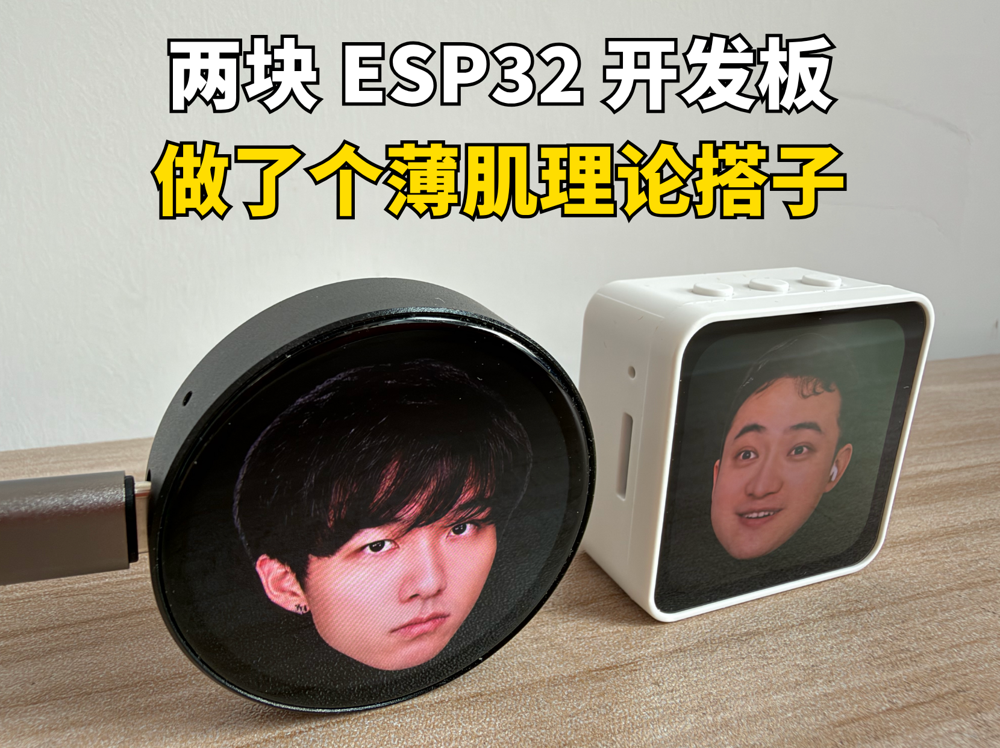

# ESP32 Sage Duet



两块 ESP32-S3 AMOLED 小板，让艾伦和孙哥在书桌上轮流接话。

按下 **PWR** 或 **BOOT**，艾伦先讲一个观点，孙哥紧接着用“太对了”回应，然后继续下一句。人物发声时会显示柔和的激活光晕和跳动画，声音结束后立即静止。

## 效果与特点

- **双板对话**：艾伦板通过 ESP-NOW 通知孙哥板播放，下一句说完后再接回去。
- **本地音频**：语录预生成并嵌入固件，日常播放不等待在线 TTS 生成。
- **薄肌语录**：当前 10 句循环播放；孙哥当前 23 条“太对了”变体。
- **适配不同屏幕**：1.75 寸圆屏使用圆形光晕，2.16 寸方屏使用圆角方形光晕。
- **播放优化**：IMA ADPCM 压缩、单声道正确复制为双声道、预下载下一对语录、250ms 接话间隔。
- **无需字幕**：只保留人物、动画和声音。

## 硬件

| 角色 | 硬件 | 当前职责 |
| --- | --- | --- |
| 艾伦（薄肌） | Waveshare ESP32-S3-Touch-AMOLED-1.75 | 播放艾伦语录，控制对话顺序 |
| 孙哥 | Waveshare ESP32-S3-Touch-AMOLED-2.16 | 接收 ESP-NOW 通知并播放“太对了” |

链接：

- [1.75 寸产品资料](https://www.waveshare.com/esp32-s3-touch-amoled-1.75.htm?&aff_id=187437)
- [2.16 寸产品资料](https://www.waveshare.com/esp32-s3-touch-amoled-2.16.htm?&aff_id=187437)

## 接话流程

```text
按键
  → 艾伦板播放本地语录
  → 声音结束，动画和光晕停止
  → 等待 250ms
  → 艾伦板通过 ESP-NOW 通知孙哥板
  → 孙哥板播放本地“太对了”
  → 孙哥板通过 ESP-NOW 回传完成通知
  → 艾伦板继续下一句
```

后端只负责会话与语录顺序。薄肌和孙哥的播放音频都已嵌入各自固件，不需要在接话时下载。

## 项目结构

```text
backend/                    FastAPI 后端、TTS/LLM/ASR 客户端
firmware/                   艾伦板固件（1.75 寸圆屏）
  main/classic_audio_shaolan/  10 条本地 ADPCM 语录
  main/classic_shaolan_audio.cpp 本地语录循环列表
  main/ui.cpp               人物动画与圆形光晕
firmware_sun/               孙哥板固件（2.16 寸方屏）
  main/classic_audio/       23 条“太对了”音频
  main/classic_sun_audio.cpp 本地音频循环列表
assets/personas/            语录、头像、参考音频与光晕素材
scripts/                    素材生成脚本
```

## 准备环境

- ESP-IDF **5.5.x**
- Python **3.11 或 3.12**
- [uv](https://docs.astral.sh/uv/)
- ffmpeg（重新处理音频或图片时需要）

## 配置

### 1. 后端

```bash
cd backend
cp .env.example .env
uv sync
```

按需编辑 `.env`：

```dotenv
DEEPSEEK_API_KEY=your-key
MODELBEST_API_KEY=your-key
MODELBEST_MODEL=VoxCPM2
ASR_DEVICE=auto
```

当前经典语录循环不调用 DeepSeek；API Key 主要用于重新生成语音或尝试其他对话功能。`.env` 已被 Git 忽略，不要提交真实密钥。

启动后端：

```bash
uv run uvicorn app.main:app --host 0.0.0.0 --port 8000
```

确认运行正常：

```bash
curl http://127.0.0.1:8000/healthz
```

### 2. 两块板子

在各自目录执行 `idf.py menuconfig`，进入 **ESP32 Sage**：

- `Wi-Fi SSID`：你的 Wi-Fi 名称；
- `Wi-Fi password`：你的 Wi-Fi 密码；
- `Backend URL on the local network`：电脑后端地址，例如 `http://192.168.2.7:8000`；
- `ESP-NOW peer MAC address`：另一块板子的 MAC；
- `ESP-NOW and Wi-Fi channel`：与路由器实际信道一致，当前默认 9。

`sdkconfig` 包含 Wi-Fi 配置，两个板的该文件均已加入 `.gitignore`。

## 构建与烧录

先加载 ESP-IDF 环境：

```bash
source /path/to/esp-idf/export.sh
```

艾伦板：

```bash
cd firmware
idf.py build
idf.py -p /dev/cu.usbmodemXXXX flash monitor
```

孙哥板：

```bash
cd firmware_sun
idf.py build
idf.py -p /dev/cu.usbmodemYYYY flash monitor
```

将端口替换为电脑实际识别到的串口。两块板都启动后，按艾伦板的 **PWR** 或 **BOOT** 开始；再按一次停止。

## 修改语录

艾伦文案位于：

```text
assets/personas/shaolan/classic_quotes.json
```

本地 ADPCM 音频位于：

```text
firmware/main/classic_audio_shaolan/
```

孙哥音频位于：

```text
firmware_sun/main/classic_audio/
```

调整数量或顺序时，需要同步：

- 音频文件序号；
- 对应的 `classic_*_audio.cpp` 播放列表；
- 对应目录 `main/CMakeLists.txt` 的 `EMBED_FILES`；
- 后端缓存音频（如果播放方式需要它）。

## 素材脚本

正常构建不需要运行这些脚本，生成文件已经包含在项目中。

```bash
# 根据现有头像重新生成 faces.c（需要 ffmpeg）
python3 scripts/prepare_firmware_assets.py

# 分别生成圆屏和方屏的预烘焙光晕（需要 Pillow）
python3 scripts/prepare_active_glow.py
```

`assets/personas/classic_audio/` 是本地生成缓存，不上传；人物研究材料和访谈全文也不纳入公开仓库。

## 版权说明

- 本项目原创代码采用 [MIT License](LICENSE)。
- 艾伦、孙哥的头像、参考原声及相关人物内容**不属于 MIT 授权**，具体来源见各人物目录的 `NOTICE.md`。
- 这是非官方二创，不宣称获得人物本人授权。
- 第三方组件和人物素材仍遵循各自许可与限制。
